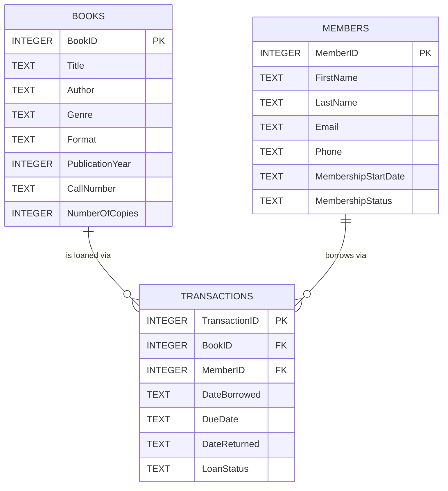

# library.db — Schema Summary

## Mermaid source

## Design summary

My library database has three tables: `Books`, `Members`, and `Transactions`.

**Books** is the catalog — every title my library owns, one row per title (not per physical copy). It exists so I have a single place to look up what a book is: its title, author, genre, format, publication year, a call number for shelving, and how many physical copies I own. **Members** is the roster of people allowed to borrow — their contact info, when they joined, and whether their account is currently in good standing (`Active`, `Suspended`, `Expired`, or `Cancelled`). It exists separately from `Transactions` because a member's identity and status outlive any individual loan. **Transactions** is the circulation log — one row per borrow event, recording which book, which member, when it was borrowed, when it's due, when (if ever) it came back, and its current status (`Checked Out`, `Returned`, `Overdue`, `Lost`). It exists because loans are events that happen *between* a book and a member, and a book or member can be involved in many of them over time.

**Relationships.** `Books` to `Transactions` is one-to-many: one book can be borrowed many times over its life, but each transaction points at exactly one book (enforced by the `BookID` foreign key). `Members` to `Transactions` is the same shape: one member can have many transactions, but each transaction belongs to exactly one member (`MemberID` foreign key). Put together, `Transactions` is really the junction table that resolves what's conceptually a many-to-many relationship between `Books` and `Members` — many members borrow many different books, and over time the same book/member pair can even show up more than once (a member who returns a book and checks it out again later). Giving `Transactions` its own `TransactionID` and one row per event is what makes that history possible instead of collapsing it into a single "who has what" lookup.

**A design decision: how I handled multiple copies.** Rather than giving every physical copy of a book its own row (Copy #1 of *The Hobbit*, Copy #2 of *The Hobbit*, etc.), I kept one row per title in `Books` with a `NumberOfCopies` count, and computed availability on the fly: a `BookAvailability` view subtracts the number of currently `Checked Out`/`Overdue` transactions for that book from `NumberOfCopies`. A `trg_copy_must_be_available` trigger uses the same logic to block a checkout when no copies are free. I chose this because, for a small library, I don't need to track which *specific* physical copy someone has — just whether one is available — and it avoids an extra `Copies` table and an extra foreign key on every transaction. The tradeoff is that I can't flag an individual copy as damaged or track its condition separately; if I ever needed that, I'd split `Books` into a `Titles` table and a `Copies` table with its own `CopyID`.

**Something Claude got wrong that I changed.** The first version of `schema.sql` enforced "publication year can't be in the future" with a `CHECK` constraint that compared `PublicationYear` to `CAST(strftime('%Y','now') AS INTEGER)`. That looked reasonable, but SQLite `CHECK` constraints are supposed to be deterministic, and pulling the current date into one isn't reliably enforced the same way across SQLite versions. When I actually read back the schema baked into `library.db`, it turned out an earlier pass had already caught this and replaced it with a `BEFORE INSERT` trigger (`trg_book_year_not_future`) that raises an error the same way the other business rules do — but `schema.sql` on disk hadn't been updated to match, so the file and the real database had quietly drifted apart. I reconciled them by updating `schema.sql` to use the trigger version and confirmed a fresh database built from the file now matches `library.db` exactly.
